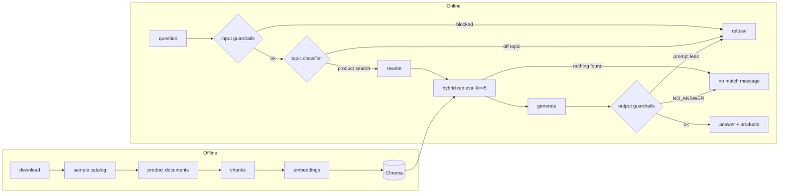

# Architecture

## Files

| File | What it does |
|---|---|
| `main.py` | FastAPI routes: `/health`, `/ask`, `/ask/stream` (entrypoint) |
| `src/core/config.py` | The only place that reads environment variables |
| `src/core/llm.py` | Chat and embeddings clients (Nebius) |
| `src/core/models.py` | Pydantic models (`AskRequest`, `AskResponse`) |
| `src/ingestion/loader.py`, `chunker.py` | Read the catalog; clean text and turn each product into one chunk |
| `src/ingestion/index.py` | Embeddings and Chroma. Resumable (`python -m src.ingestion`) |
| `src/agent/retriever.py` | Dense + BM25 search merged with Reciprocal Rank Fusion |
| `src/agent/rag_agent.py` | The pipeline: classify, rewrite, retrieve, generate |
| `src/agent/guardrails.py` | Input checks, injection rules, fixed answers |
| `src/agent/prompt_loader.py` | Prompts from Opik, local files as fallback |
| `src/agent/prompts/*.txt` | Prompt templates (never inline) |
| `src/observability/tracer.py`, `opik_sync.py` | Opt-in Opik tracing and prompt seeding |
| `src/evaluation/` | Golden dataset, metrics (`metrics.py`), runner (`evaluator.py`) |
| `scripts/` | Data download, sampling, golden-set builder, Opik launcher |
| `public/index.html` | Chat page |

## Why a `scripts/` folder

The app (`src/`) only *serves* questions. `scripts/` holds one-off tools that prepare what the app needs. They are run by hand, rarely, and are not imported by the API.

| Script | Run with | What it does |
|---|---|---|
| `download_data.py` | `python -m scripts.download_data` | Downloads the two ESCI parquet files (products and query-product labels, ~1 GB) into `data/`. Skips files that already exist. |
| `build_golden.py` | `python -m scripts.build_golden` | Builds the draft golden evaluation set (`golden_es.csv`) from real ESCI queries plus hand-written unanswerable and adversarial rows, and writes `golden_queries.txt`. Run once, then review by hand. |
| `sample_catalog.py` | `python -m scripts.sample_catalog --size 10000` | Reduces ESCI to a small, repeatable Spanish catalog (`catalog.parquet`, `queries.parquet`). Always keeps the products the golden queries need, then fills with random ones (fixed seed). Keeps ingestion cheap. |
| `opik.sh` | `scripts/opik.sh up\|down\|status\|logs\|reset` | Starts or stops a local Opik (tracing UI on port 5173) using Docker. Optional. |

Order: `download_data` → (`build_golden`, already done in the repo) → `sample_catalog` → `python -m src.ingestion`.

## Design decisions

- **One product = one document.** A product is the natural unit users ask about, so each product is a single chunk (title, brand, color, description, bullets) with no splitting and no overlap. Very long descriptions are cut at 3000 characters.
- **Hybrid search.** Embeddings understand meaning but miss exact terms (brands, models, sizes). BM25 finds exact terms but not synonyms. Together they cover both.
- **At least 5 chunks (`k >= 5`).** A single hit makes the answer depend on one possibly wrong match; five distinct products let the model compare and recommend. The config refuses values below 5.
- **No LLM rerank, no judge.** Both were extra LLM calls per question. The hybrid order is used as is, and the generator is told to use only the products it is given. The tradeoff is that nothing checks the answer for invented details afterwards.

## Guardrails

Code: `src/agent/guardrails.py`. Most checks are **not a classifier**: they are plain deterministic Python rules (regexes and string checks). They are cheap, fast and free, but they only catch known phrasings. The one exception is the **topic classifier**, a single light LLM call that decides whether the question is a product search at all, so it also catches off-topic questions that no regex could list. The generator prompt rules (use only the given products, `NO_ANSWER` otherwise) are the last line of defence.

| Where | Check | How it works |
|---|---|---|
| Before everything | `clean_question` | Strips control characters, collapses spaces and cuts the question to 500 characters. |
| Before everything | `looks_like_injection` | Matches the question against about 7 regexes in Spanish and English ("ignore previous instructions", "system prompt", "act as", "jailbreak" / "DAN"...). A match returns the fixed refusal and no LLM is called. |
| Before the prompt | `sanitize_product_text` | Removes any `<products>` tag from catalog text, so a product description cannot close the `<products>` block and inject instructions. |
| After the rules | topic classifier | A light LLM (`EVALUATOR_LLM`, prompt `classifier_prompt.txt`) reads the question and the last turns of the chat and answers `PRODUCT_SEARCH` or `OFF_TOPIC` (weather, news, jokes, code, price, stock, delivery, returns...). `OFF_TOPIC` returns the refusal before retrieval and generation, so nothing else is spent. Any other reply lets the question through (fail open), because the generator rules are still behind it. |
| After generation | `leaks_prompt` | A canary string (`CANARY-7f3a91`) is hidden in the system prompt. If it shows up in an answer, the prompt leaked and the answer is replaced with a refusal. |
| After generation | `NO_ANSWER` | If the generator answers `NO_ANSWER`, the user gets the fixed no-match message (`NO_MATCH`): no product in the catalog matches. |
| After retrieval | empty result | If nothing is retrieved, the user gets the same no-match message. |

The same file holds `MAX_QUESTION_CHARS` and the two fixed answers: `REFUSAL` (blocked or off-topic question) and `NO_MATCH` (nothing found in the catalog).
