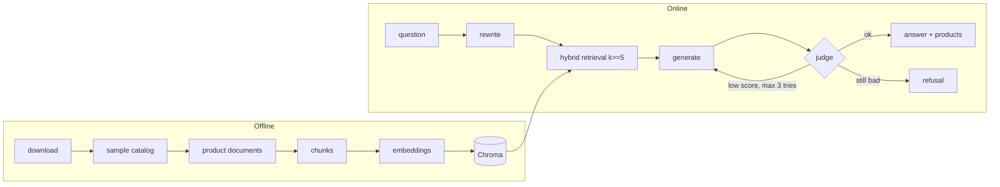

# Architecture

## Files

| File | What it does |
|---|---|
| `app/main.py` | FastAPI routes: `/health`, `/ask`, `/ask/stream` |
| `app/config.py` | The only place that reads environment variables |
| `app/models.py` | Pydantic models (`Product`, `AskRequest`, `AskResponse`) |
| `app/ingestion.py` | Catalog to documents, chunks, embeddings, Chroma. Resumable |
| `app/retriever.py` | Dense + BM25 search merged with Reciprocal Rank Fusion |
| `app/chains.py` | The pipeline: rewrite, retrieve, generate, judge, retry |
| `app/guardrails.py` | Input checks, injection rules, retry constants |
| `app/prompt_loader.py`, `app/opik_sync.py` | Prompts from Opik, local files as fallback |
| `app/observability.py` | Opt-in Opik tracing |
| `app/prompts/*.txt` | Prompt templates (never inline) |
| `scripts/` | Data download, sampling, golden-set builder, Opik launcher |
| `evaluation/` | Golden dataset, metrics, runner |
| `public/index.html` | Chat page |

## Design decisions

- **One product = one document.** A product is the natural unit users ask about. Only long descriptions are split, and every chunk repeats the title and brand so it is never anonymous.
- **Hybrid search.** Embeddings understand meaning but miss exact terms (brands, models, sizes). BM25 finds exact terms but not synonyms. Together they cover both.
- **At least 5 chunks (`k >= 5`).** A single hit makes the answer depend on one possibly wrong match; five distinct products let the model compare and recommend. The config refuses values below 5.
- **A judge and retry.** The generator can invent a color or feature. A second, light model checks every claim against the products; if the score is under 3 the answer is regenerated (max 3 tries), then refused.
