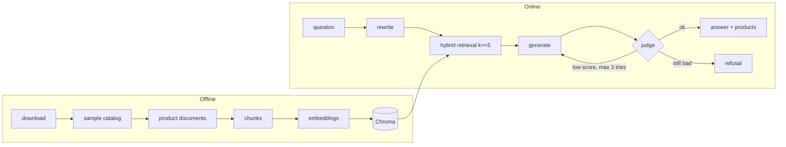

# Architecture

## Files

| File | What it does |
|---|---|
| `main.py` | FastAPI routes: `/health`, `/ask`, `/ask/stream` (entrypoint) |
| `src/core/config.py` | The only place that reads environment variables |
| `src/core/llm.py` | Chat and embeddings clients (Nebius) |
| `src/core/models.py` | Pydantic models (`AskRequest`, `AskResponse`) |
| `src/ingestion/loader.py`, `chunker.py` | Read the catalog; clean text and turn each product into one chunk |
| `src/ingestion/index.py` | Embeddings and Chroma. Resumable (`python -m src.ingestion`) |
| `src/agent/retriever.py` | Dense + BM25 search merged with Reciprocal Rank Fusion |
| `src/agent/rag_agent.py` | The pipeline: rewrite, retrieve, generate, judge, retry |
| `src/agent/guardrails.py` | Input checks, injection rules, retry constants |
| `src/agent/prompt_loader.py` | Prompts from Opik, local files as fallback |
| `src/agent/prompts/*.txt` | Prompt templates (never inline) |
| `src/observability/tracer.py`, `opik_sync.py` | Opt-in Opik tracing and prompt seeding |
| `src/evaluation/` | Golden dataset, metrics (`metrics.py`), runner (`evaluator.py`) |
| `scripts/` | Data download, sampling, golden-set builder, Opik launcher |
| `public/index.html` | Chat page |

## Design decisions

- **One product = one document.** A product is the natural unit users ask about, so each product is a single chunk (title, brand, color, description, bullets) with no splitting and no overlap. Very long descriptions are cut at 3000 characters.
- **Hybrid search.** Embeddings understand meaning but miss exact terms (brands, models, sizes). BM25 finds exact terms but not synonyms. Together they cover both. An LLM then reranks the top products by relevance to the question (one extra call).
- **At least 5 chunks (`k >= 5`).** A single hit makes the answer depend on one possibly wrong match; five distinct products let the model compare and recommend. The config refuses values below 5.
- **A judge and retry.** The generator can invent a color or feature. A second, light model checks every claim against the products; if the score is under 3 the answer is regenerated (max 3 tries), then refused.
