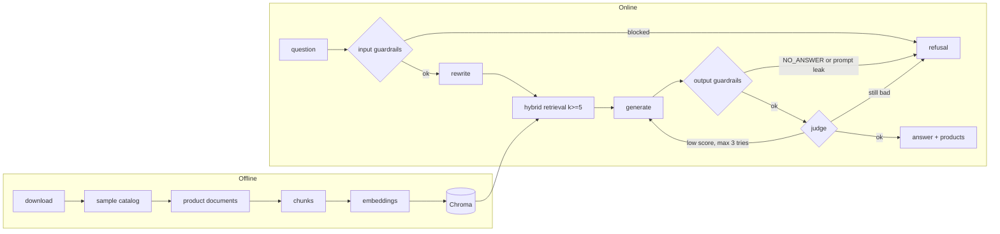

# Architecture

## Files

| File | What it does |
|---|---|
| `main.py` | FastAPI routes: `/health`, `/ask`, `/ask/stream` (entrypoint) |
| `src/core/config.py` | The only place that reads environment variables |
| `src/core/llm.py` | Chat and embeddings clients (Nebius) |
| `src/core/models.py` | Pydantic models (`AskRequest`, `AskResponse`) |
| `src/ingestion/loader.py`, `chunker.py` | Read the catalog; clean text and turn each product into one chunk |
| `src/ingestion/index.py` | Embeddings and Chroma. Resumable (`python -m src.ingestion`) |
| `src/agent/retriever.py` | Dense + BM25 search merged with Reciprocal Rank Fusion |
| `src/agent/rag_agent.py` | The pipeline: rewrite, retrieve, generate, judge, retry |
| `src/agent/guardrails.py` | Input checks, injection rules, retry constants |
| `src/agent/prompt_loader.py` | Prompts from Opik, local files as fallback |
| `src/agent/prompts/*.txt` | Prompt templates (never inline) |
| `src/observability/tracer.py`, `opik_sync.py` | Opt-in Opik tracing and prompt seeding |
| `src/evaluation/` | Golden dataset, metrics (`metrics.py`), runner (`evaluator.py`) |
| `scripts/` | Data download, sampling, golden-set builder, Opik launcher |
| `public/index.html` | Chat page |

## Why a `scripts/` folder

The app (`src/`) only *serves* questions. `scripts/` holds one-off tools that prepare what the app needs. They are run by hand, rarely, and are not imported by the API.

| Script | Run with | What it does |
|---|---|---|
| `download_data.py` | `python -m scripts.download_data` | Downloads the two ESCI parquet files (products and query-product labels, ~1 GB) into `data/`. Skips files that already exist. |
| `build_golden.py` | `python -m scripts.build_golden` | Builds the draft golden evaluation set (`golden_es.csv`) from real ESCI queries plus hand-written unanswerable and adversarial rows, and writes `golden_queries.txt`. Run once, then review by hand. |
| `sample_catalog.py` | `python -m scripts.sample_catalog --size 10000` | Reduces ESCI to a small, repeatable Spanish catalog (`catalog.parquet`, `queries.parquet`). Always keeps the products the golden queries need, then fills with random ones (fixed seed). Keeps ingestion cheap. |
| `opik.sh` | `scripts/opik.sh up\|down\|status\|logs\|reset` | Starts or stops a local Opik (tracing UI on port 5173) using Docker. Optional. |

Order: `download_data` → (`build_golden`, already done in the repo) → `sample_catalog` → `python -m src.ingestion`.

## Design decisions

- **One product = one document.** A product is the natural unit users ask about, so each product is a single chunk (title, brand, color, description, bullets) with no splitting and no overlap. Very long descriptions are cut at 3000 characters.
- **Hybrid search.** Embeddings understand meaning but miss exact terms (brands, models, sizes). BM25 finds exact terms but not synonyms. Together they cover both. An LLM then reranks the top products by relevance to the question (one extra call).
- **At least 5 chunks (`k >= 5`).** A single hit makes the answer depend on one possibly wrong match; five distinct products let the model compare and recommend. The config refuses values below 5.
- **A judge and retry.** The generator can invent a color or feature. A second, light model checks every claim against the products; if the score is under 3 the answer is regenerated (max 3 tries), then refused.

## Guardrails

Code: `src/agent/guardrails.py`. They are **not a classifier**: there is no ML model and no LLM call, only plain deterministic Python rules (regexes and string checks). They are cheap, fast and free, but they only catch known phrasings. A paraphrased injection can get through, and the [judge](#judge) is the second line of defence for that case.

| Where | Check | How it works |
|---|---|---|
| Before everything | `clean_question` | Strips control characters, collapses spaces and cuts the question to 500 characters. |
| Before everything | `looks_like_injection` | Matches the question against about 7 regexes in Spanish and English ("ignore previous instructions", "system prompt", "act as", "jailbreak" / "DAN"...). A match returns the fixed refusal and no LLM is called. |
| Before the prompt | `sanitize_product_text` | Removes any `<products>` tag from catalog text, so a product description cannot close the `<products>` block and inject instructions. |
| After generation | `leaks_prompt` | A canary string (`CANARY-7f3a91`) is hidden in the system prompt. If it shows up in an answer, the prompt leaked and the answer is replaced with a refusal. |
| After generation | `NO_ANSWER` | If the generator answers `NO_ANSWER`, the user gets the refusal. |
| After retrieval | empty result | If nothing is retrieved, the user gets the refusal. |

The same file holds the constants that control the retry loop (`MAX_QUESTION_CHARS`, `MIN_JUDGE_SCORE`, `MAX_ATTEMPTS`). Changing them needs approval (see `AGENTS.md`).

## Judge

Code: `Pipeline.judge_answer` in `src/agent/rag_agent.py`, prompt in `src/agent/prompts/judge_prompt.txt`.

The judge is a second LLM call that fact-checks the generated answer against the retrieved products.

- **Input:** the question, the retrieved product text and the generated answer.
- **Output:** JSON like `{"grounded": true, "score": 1-5, "unsupported_claims": ["..."]}`. Every claim about a product (brand, color, features, what it is for) must be written in the products.
- **Model:** a separate, lighter model (`EVALUATOR_LLM`), not the generator (`GENERATOR_LLM`).
- **Score 3 or higher** (`MIN_JUDGE_SCORE`): the answer is accepted and returned with the products it mentions.
- **Score lower than 3:** the unsupported claims are sent back to the generator as feedback and it tries again. The streaming endpoint sends a `reset` event so the page clears the text.
- **After 3 attempts** (`MAX_ATTEMPTS`): the user gets the refusal with `grounded=false`.
- **Invalid JSON from the judge:** counts as score 1, so the check fails safe.
