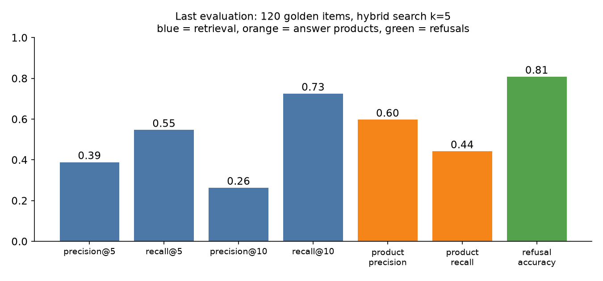
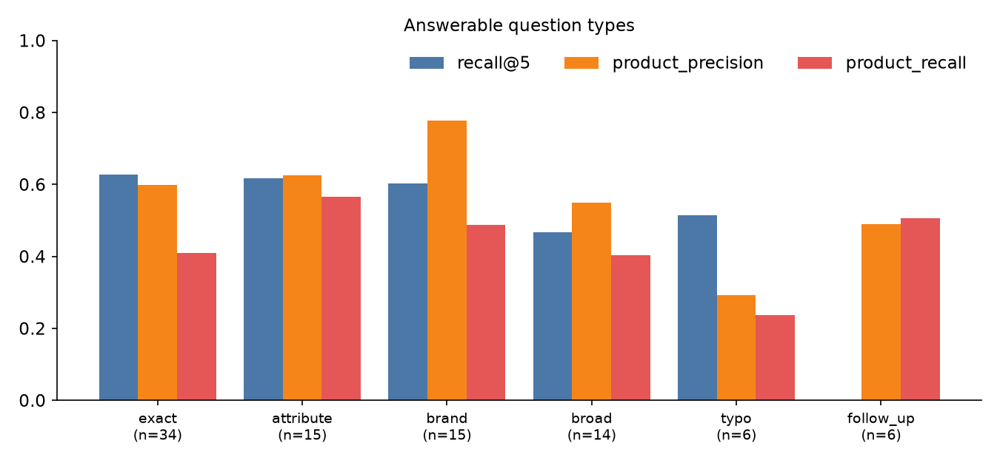

# Evaluation report

Last run: **2026-11-08**, Opik experiment `hybrid-k5-deepseek-ai/DeepSeek-V4-Flash-0731`. Full pipeline (not retrieval only) over the 120 golden items, hybrid search (dense + BM25), `k=5`, catalog of 2,000 products. The numbers are also saved in [`assets/eval-report.json`](assets/eval-report.json).

> **Update:** recommendations 1, 2, 3 and 6 below were applied. See the [report after the fixes](report-after-fixes.md) for the new run next to these numbers.

> The golden dataset is still a **draft** (see [Evaluation](evaluation.md)). Read the results as a baseline to improve on, not as a final grade.

## Models used

| Role | Model (Nebius) | Where |
|---|---|---|
| Generator and rewriter | `deepseek-ai/DeepSeek-V4-Flash-0731` | `GENERATOR_LLM` |
| Topic classifier | `nvidia/Nemotron-3_5-Lightning` | `EVALUATOR_LLM` |
| Embeddings | `BAAI/bge-multilingual-gemma2` (default) | `EMBEDDINGS_MODEL` |

The names come from the Opik experiment config and spans (the defaults in `.env.example` are different Llama models). Both chat models are **reasoning models**: they spend tokens "thinking" before they answer. This matters for cost and speed, see below.

## What each metric means

Example: the user wanted products A and B and the system returned `[A, x, B, y, z]`.

| Metric | Question it answers | How it is computed | Example |
|---|---|---|---|
| **precision@5** | Of the 5 products retrieved, how many are relevant? | relevant in top 5 / 5 | 2/5 = 0.40 |
| **recall@5** | Of the products the user wanted, how many are in the top 5? | relevant in top 5 / all relevant | 2/2 = 1.00 |
| **precision@10 / recall@10** | Same with the top 10: shows if the right product is found but ranked low | | |
| **product_precision** | Of the products the assistant **recommended in its answer**, how many are right? | right recommended / recommended | |
| **product_recall** | Of the right products, how many did the answer **recommend**? | right recommended / all right | |
| **refusal_accuracy** | Does it refuse exactly when it should? | 1 if (refused == question is unanswerable) | 0 or 1 |

*Relevant* = ESCI label E (exact) from the golden set. The first four measure the **retriever**, the next two the **whole answer** (retriever + generator), the last one the **guardrails**. Precision is low by design: many questions have only 1 or 2 right products, so precision@5 cannot be higher than about 0.2 to 0.4.

## Results

| Metric | Value |
|---|---|
| precision@5 | 0.389 |
| recall@5 | 0.547 |
| precision@10 | 0.263 |
| recall@10 | 0.725 |
| product_precision | 0.597 |
| product_recall | 0.442 |
| refusal_accuracy | 0.808 |

Latency per question: p50 7.4 s, p90 13.1 s, p99 32.3 s.

### By question type

| Type | n | recall@5 | recall@10 | product_precision | product_recall | refusal_accuracy |
|---|---|---|---|---|---|---|
| exact | 34 | 0.626 | 0.808 | 0.599 | 0.410 | 0.676 |
| attribute | 15 | 0.617 | 0.770 | 0.624 | 0.566 | 0.800 |
| brand | 15 | 0.602 | 0.867 | 0.778 | 0.487 | 0.933 |
| broad | 14 | 0.468 | 0.648 | 0.550 | 0.402 | 0.714 |
| typo | 6 | 0.514 | 0.611 | 0.292 | 0.236 | 0.500 |
| follow_up | 6 | 0.000* | 0.083* | 0.489 | 0.506 | 0.833 |
| unanswerable | 18 | - | - | - | - | **1.000** |
| adversarial | 12 | - | - | - | - | **1.000** |

\* The follow-up retrieval numbers are an **evaluator artifact**: with the full pipeline the evaluator measures retrieval on the raw text ("¿Y en negro?") without the rewrite step. The end-to-end columns (product_precision/recall) are the real ones for follow-ups.

### How to read it

- **Guardrails work**: all 18 unanswerable and all 12 adversarial questions were refused (1.00).
- **The weak point is false refusals.** refusal_accuracy is 0.81 because 23 of the 90 answerable questions (26%) were refused or answered "no match": 10 stopped before the generator was called, 13 reached it and still ended without a recommendation.
- **Right products are found but ranked low**: recall goes from 0.55 (top 5) to 0.73 (top 10). A reranker or a larger candidate set would recover part of that.
- **Precision of the answer (0.60) is better than its recall (0.44)**: when the assistant recommends something it is usually right, but it recommends too few products.
- **Typos and broad queries are the hardest**: the lexical part (BM25) cannot match misspelled words, and "broad" queries have many acceptable products that are not labeled E.

## Token usage and cost

Opik records the usage of each LLM call. Average per question over the 120 items, from the experiment:

| | Per question | 120 questions |
|---|---|---|
| Prompt tokens | 196 | 23.5k |
| Completion tokens | 591 | 71.0k |
| of which reasoning tokens | 585 | 70.2k |
| **Total** | **788** | **94.5k** |

By model (spans with usage recorded):

| Model | Calls | Prompt | Completion | Median call |
|---|---|---|---|---|
| Nemotron-3_5-Lightning (classifier) | 110 | 21.1k | 64.4k (63.8k reasoning) | 2.1 s |
| DeepSeek-V4-Flash-0731 (generator, rewriter) | 7 | 0.5k | 0.6k | 3.4 s |

**Two findings:**

1. **The classifier is the most expensive step and it only returns one label.** About 99% of its completion tokens are reasoning (about 580 per call) for an answer of a few tokens.
2. **The generator cost is not measured.** The generator streams its answer and the stream does not report usage, so 86 of its 93 calls have no token data. The total above is therefore a **lower bound**. See the recommendations.

Indicative price: the classifier is about 0.0001 USD per question (about 0.13 USD per 1,000 questions) using 0.05 USD / 1M input and 0.20 USD / 1M output tokens. **These prices come from third-party price trackers, not from Nebius**: check the Nebius price page and set your own. The whole run of 120 questions cost a few cents; embedding the 2,000 products is cheaper (`EMBEDDINGS_PRICE_PER_1M`, shown before ingesting).

## Recommendations

Ordered by expected gain per effort. Change one thing at a time and re-run the evaluation; never edit the golden set to improve a score.

1. **Turn off thinking in the classifier (or use a non-reasoning model).** Saves about 580 tokens and about 2 s per question, with no quality loss for a one-word label. The Llama 3.1 8B in `.env.example` is enough for this step.
2. **Capture the generator usage.** Pass `stream_usage=True` to `ChatOpenAI` in `src/core/llm.py`. Without it the cost report is incomplete.
3. **Reduce false refusals.** Open the 23 refused answerable items in Opik and check where they stopped: classifier, `RETRIEVAL_MIN_SCORE` (0.2) or the generator. Lowering the threshold or making the classifier prompt less strict are the first things to try.
4. **Rerank.** Retrieve 20 candidates and rerank them (cross-encoder or a small LLM call) before passing 5 to the generator. Targets recall@5 (0.55 versus 0.73 at 10).
5. **Handle typos.** Add a spelling-correction step (or use the rewriter) before BM25. Typos score 0.51 recall@5 and 0.24 product_recall.
6. **Let the answer recommend more.** product_recall (0.44) trails product_precision (0.60): ask the generator for up to 3 products when several are relevant.
7. **Evaluate follow-ups end to end.** Make the evaluator run the rewrite before measuring retrieval, so the follow-up rows are meaningful.
8. **Compare models.** Run `python -m src.evaluation.evaluator --generator <model>` with a non-reasoning generator and compare the experiments in Opik: quality, latency (p50 7.4 s now) and tokens side by side.
9. **Review the golden dataset** (labels are ESCI, answers are templates) before drawing final conclusions.
10. **Cache** repeated questions and the classifier result to avoid paying twice.
