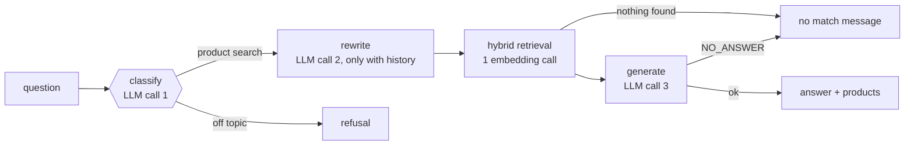

<p align="center"></p>

# rag-ecommerce

[](https://github.com/fsystemweb/rag-ecommerce/actions/workflows/ci.yml)
   

An educational **product search assistant** built with RAG: it answers only from a catalog of thousands of Spanish-language products (Amazon ESCI), cites the products it recommends, and is measured with a labeled golden dataset.

⚠️ Educational project, not production-ready. Using it calls the Nebius AI Studio API and costs a little money (ingestion, each question, evaluation).

## Features

- **Hybrid search:** embeddings (Chroma) plus BM25, merged with Reciprocal Rank Fusion.
- **Grounded answers:** the answer only uses retrieved products and names them.
- **Guardrails:** input checks, prompt-injection rules and a light topic classifier; it refuses price, stock and delivery questions.
- **No match:** when nothing in the catalog fits, it says so with a fixed message.
- **Streaming API:** `/ask` and `/ask/stream`, plus a one-page chat UI.
- **Evaluation and tracing:** a labeled golden dataset with offline metrics and optional Opik traces.

## How it works



A question makes 2 or 3 chat-LLM calls (classify, rewrite for follow-ups only, generate) plus 1 embedding call. Details in the [architecture page](docs/architecture.md#llm-calls-per-question).

## Requirements

- Python 3.12
- A [Nebius AI Studio](https://studio.nebius.com/) API key
- Docker (only for the optional Opik tracing)

## Quick start

```bash
python3 -m venv .venv && source .venv/bin/activate
pip install -r requirements-dev.txt
cp .env.example .env            # set NEBIUS_API_KEY
python -m scripts.download_data # ~1 GB, once
python -m scripts.sample_catalog --size 2000
python -m src.ingestion         # embeds the catalog (paid, asks to confirm)
python main.py              # API on :8000
python -m http.server 5500      # chat page: http://localhost:5500/public/
```

Try it: `curl -X POST localhost:8000/ask -H 'content-type: application/json' -d '{"question":"auriculares inalámbricos para correr"}'`

## API

| Route | What it does |
|---|---|
| `GET /health` | Liveness check |
| `POST /ask` | `{"question": "...", "history": [...]}` returns the answer and the recommended products |
| `POST /ask/stream` | Same, streamed |

## Project layout

```
main.py          FastAPI entrypoint
src/core/        config, LLM clients, models
src/ingestion/   loader, chunker, indexing
src/agent/       RAG pipeline, retriever, guardrails, prompts/*.txt
src/evaluation/  golden dataset and metrics
src/observability/ Opik tracing
scripts/         data download and sampling
public/          static chat page
tests/           offline tests (fake LLM and embeddings)
```

## Development

```bash
pytest && python -m src.evaluation.test_metrics   # offline, free
ruff check . && ruff format --check .             # CI runs the same
```

## Learn more

Full docs: https://fsystemweb.github.io/rag-ecommerce/ (sources in [`docs/`](docs/), `npx docsify-cli serve docs`).
Contributor rules: [`AGENTS.md`](AGENTS.md). Tests: `pytest`.

## Observability (optional)

[Comet Opik](https://github.com/comet-ml/opik) shows every question as a trace (classify, rewrite, retrieval, generation) and can hold the prompts. It needs Docker.

```bash
scripts/opik.sh up                  # UI on http://localhost:5173
# in .env: OPIK_URL_OVERRIDE=http://localhost:5173/api
```

Without `OPIK_URL_OVERRIDE` nothing changes. Prompts are read from Opik first (names `rag-ecommerce-generator|classifier|rewriter`) and fall back to `src/agent/prompts/*.txt`.

## Cost

Each question calls Nebius 2 to 3 times (classifier, rewriter only for follow-ups, generator) plus one embedding, with 5 products in the prompt. Ingestion and evaluation also cost money.
